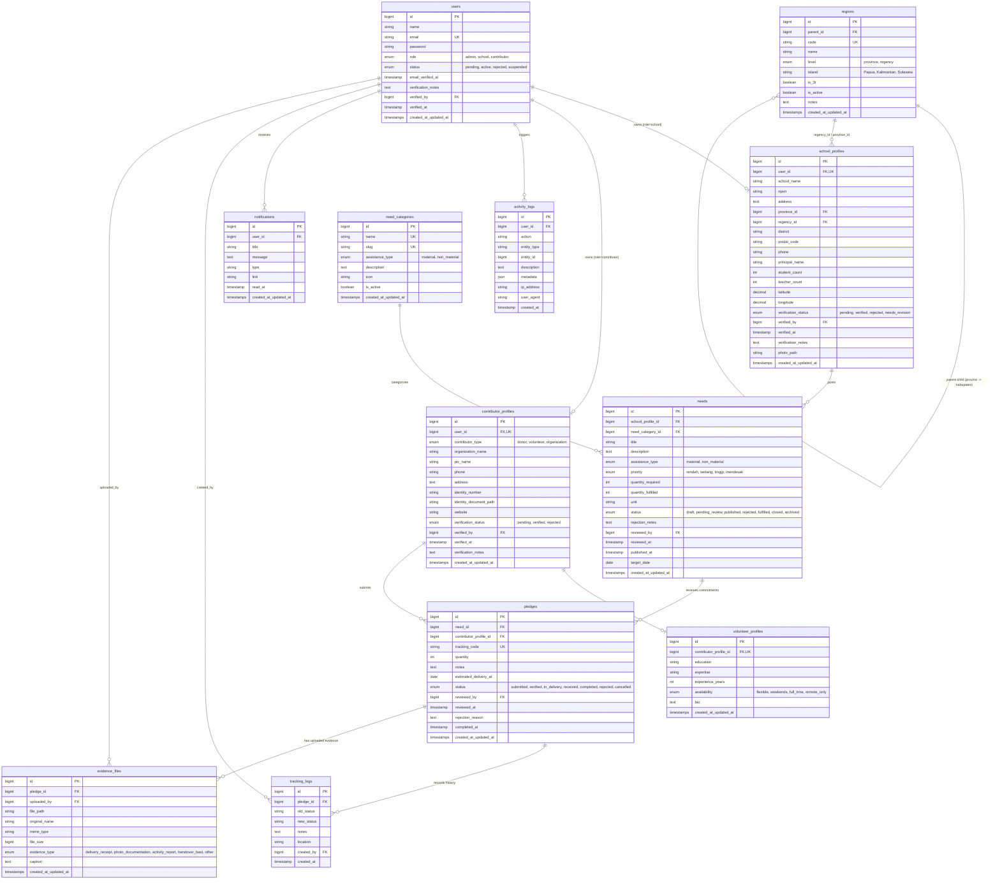

# SambungAsa — Database Schema & Data Dictionary

> **Spesifikasi Skema Basis Data & Kamus Data**  
> Database Engine: MySQL 8.0+  
> Database Name: `sambungasa`  
> Charset: `utf8mb4` | Collation: `utf8mb4_unicode_ci`  
> Terakhir diperbarui: 28 Oktober 2026

---

## 1. Entity Relationship Diagram (ERD)

---

## 2. Definisi Tabel dan Kamus Data

### 2.1 Tabel `users`
Menyimpan identitas autentikasi semua aktor di sistem SambungAsa.
- `id`: Primary key auto-increment.
- `name`: Nama lengkap pengguna atau contact person.
- `email`: Alamat surel (unique), digunakan untuk kredensial login.
- `password`: String hash menggunakan algoritma Bcrypt bawaan Laravel.
- `role`: Peran pengguna:
  - `admin`: Pengelola platform (verifikator, moderator, reporting).
  - `school`: Perwakilan sekolah wilayah 3T.
  - `contributor`: Donatur, relawan perorangan, atau organisasi mitra.
- `status`: Status aktifasi akun:
  - `pending`: Menunggu pemeriksaan admin (untuk pendaftaran baru).
  - `active`: Akun aktif dan dapat melakukan transaksi data sesuai perannya.
  - `rejected`: Akun ditolak admin karena data tidak valid.
  - `suspended`: Akun dinonaktifkan sementara oleh admin.
- `verification_notes`: Catatan review admin saat verifikasi akun.
- `verified_by`: ID user admin yang memverifikasi akun (FK -> `users.id`).
- `verified_at`: Waktu eksekusi verifikasi.

### 2.2 Tabel `regions`
Menyimpan data hierarki wilayah administratif dan status penetapan wilayah 3T.
- `id`: Primary key.
- `parent_id`: ID provinsi untuk record kabupaten/kota (FK -> `regions.id`). Null untuk provinsi.
- `code`: Kode wilayah resmi (e.g. `ID-PA` untuk Papua, `ID-PA-JPR` untuk Jayapura).
- `name`: Nama provinsi atau kabupaten/kota.
- `level`: `province` atau `regency`.
- `island`: Kelompok pulau fokus MVP: `Papua`, `Kalimantan`, `Sulawesi`.
- `is_3t`: Boolean (true jika ditetapkan sebagai wilayah 3T berdasarkan referensi resmi).
- `is_active`: Status keaktifan wilayah di sistem.

### 2.3 Tabel `school_profiles`
Profil lengkap sekolah 3T yang terhubung 1-to-1 dengan akun user role `school`.
- `id`: Primary key.
- `user_id`: Foreign key unique -> `users.id`.
- `school_name`: Nama resmi sekolah (e.g. `SD Inpres Waisilip`).
- `npsn`: Nomor Pokok Sekolah Nasional (8 digit).
- `address`: Alamat lengkap sekolah.
- `province_id`: Foreign key -> `regions.id`.
- `regency_id`: Foreign key -> `regions.id`.
- `district`: Nama kecamatan.
- `latitude`, `longitude`: Koordinat lokasi geografis sekolah.
- `verification_status`:
  - `pending`: Profil baru atau diperbarui, menunggu verifikasi lokasi 3T oleh admin.
  - `verified`: Lokasi dan legalitas sekolah terkonfirmasi valid sebagai sekolah 3T.
  - `rejected`: Ditolak verifikasi.
  - `needs_revision`: Memerlukan perbaikan dokumen/data oleh perwakilan sekolah.
- `verified_by`: Admin pemeriksa (FK -> `users.id`).
- `verified_at`: Waktu verifikasi.
- `verification_notes`: Alasan penolakan / instruksi revisi dari admin.

### 2.4 Tabel `contributor_profiles` & `volunteer_profiles`
Profil donatur, relawan, atau organisasi yang terhubung 1-to-1 dengan akun user role `contributor`.
- `contributor_type`: `donor`, `volunteer`, `organization`.
- `organization_name`: Nama organisasi jika bertindak atas nama lembaga.
- `identity_number`: NIK / NPWP / No. Izin Organisasi (disimpan aman, tidak tampil di direktori publik).
- `identity_document_path`: Dokumen verifikasi legalitas/identitas di private storage.
- Relasi 1-to-1 opsional ke `volunteer_profiles` mencakup: `education`, `expertise` (bidang keahlian), `experience_years`, `availability`, dan `bio`.

### 2.5 Tabel `need_categories`
Daftar kategori kebutuhan sekolah.
- Kategori default:
  1. *Buku & Alat Tulis* (material)
  2. *Elektronik & Komputer* (material)
  3. *Infrastruktur & Bangunan* (material)
  4. *Pelatihan & Pengajaran* (non_material)
  5. *Lainnya* (material/non_material)

### 2.6 Tabel `needs`
Katalog kebutuhan yang diajukan oleh sekolah yang telah terverifikasi.
- `school_profile_id`: FK -> `school_profiles.id`.
- `need_category_id`: FK -> `need_categories.id`.
- `title`: Judul kebutuhan singkat dan jelas.
- `description`: Penjelasan latar belakang dan urgensi kebutuhan.
- `assistance_type`: `material` atau `non_material`.
- `priority`: `rendah`, `sedang`, `tinggi`, `mendesak`.
- `quantity_required`: Jumlah kuantitas yang dibutuhkan (misal: 50).
- `quantity_fulfilled`: Jumlah yang telah berhasil disalurkan dan terkonfirmasi selesai.
- `unit`: Satuan (e.g. `paket`, `unit`, `eksemplar`, `orang/sesi`).
- `status`:
  - `draft`: Kebutuhan sedang disusun oleh sekolah.
  - `pending_review`: Diajukan ke admin untuk moderasi.
  - `published`: Lolos moderasi admin, tampil di direktori publik dan dapat menerima pledge.
  - `rejected`: Ditolak oleh admin moderator dengan catatan.
  - `fulfilled`: Kebutuhan terpenuhi 100%.
  - `closed`: Ditutup manual oleh sekolah atau admin.
  - `archived`: Diarsipkan untuk kebutuhan histori.

### 2.7 Tabel `pledges`
Komitmen penyaluran bantuan dari donatur/relawan/organisasi terhadap suatu kebutuhan.
- `need_id`: FK -> `needs.id`.
- `contributor_profile_id`: FK -> `contributor_profiles.id`.
- `tracking_code`: Kode unik acak berformat `SA-YYYYMM-XXXX` (e.g. `SA-202610-8841`).
- `quantity`: Jumlah unit/kapasitas yang dikomitmenkan.
- `status`:
  - `submitted`: Pengajuan baru dari donatur, menunggu review admin.
  - `verified`: Disetujui admin untuk dilanjutkan ke proses pengiriman/pelaksanaan.
  - `in_delivery`: Bantuan sedang dikirim atau kegiatan sedang berlangsung.
  - `received`: Bantuan telah tiba di sekolah dan diterima perwakilan sekolah.
  - `completed`: Selesai diverifikasi akhir dengan bukti serah terima lengkap.
  - `rejected`: Pengajuan bantuan ditolak admin (disertai `rejection_reason`).
  - `cancelled`: Dibatalkan oleh donatur sebelum verifikasi.

### 2.8 Tabel `tracking_logs`
Catatan kronologis perjalanan status bantuan.
- `pledge_id`: FK -> `pledges.id`.
- `old_status`, `new_status`: Perubahan status yang terjadi.
- `notes`: Catatan perkembangan logistik / dokumentasi pengiriman.
- `created_by`: User yang memicu perubahan status (FK -> `users.id`).

### 2.9 Tabel `evidence_files`
Metadata berkas bukti (foto serah terima, resi pengiriman, BAST, sertifikat kegiatan).
- `pledge_id`: FK -> `pledges.id`.
- `file_path`: Path file di dalam `storage/app/private/evidence/`. File ini tidak dapat diakses langsung via URL publik.
- `mime_type`: e.g. `image/jpeg`, `image/png`, `application/pdf`.
- `file_size`: Ukuran file dalam bytes.
- `evidence_type`: `delivery_receipt`, `photo_documentation`, `activity_report`, `handover_bast`, `other`.

### 2.10 Tabel `notifications` & `activity_logs`
- `notifications`: Notifikasi internal in-app dengan status `read_at`.
- `activity_logs`: Jejak audit sistem mencatat aktor, aksi, tipe entitas, ID entitas, deskripsi, alamat IP, dan user-agent.

---

## 3. Aturan Integritas Data & Indeks Kinerja

1. **Foreign Key Constraints**: Seluruh relasi child menggunakan `ON DELETE CASCADE` untuk data profil milik user, dan `ON DELETE RESTRICT` pada kebutuhan atau pledge yang telah memiliki transaksi aktif.
2. **Pledge Allocation Protection**: Kuantitas `pledges` yang disetujui tidak boleh melampaui sisa kebutuhan:
   `sum(verified + in_delivery + received + completed) <= needs.quantity_required`.
   Pemeriksaan dilakukan dalam transaksi database dengan `lockForUpdate()`.
3. **Pencarian & Filtering**:
   - Indeks pada `needs (status, priority, need_category_id)`.
   - Indeks pada `school_profiles (regency_id, verification_status)`.
   - Indeks pada `pledges (tracking_code, status)`.
   - Indeks pada `activity_logs (user_id, created_at)`.
